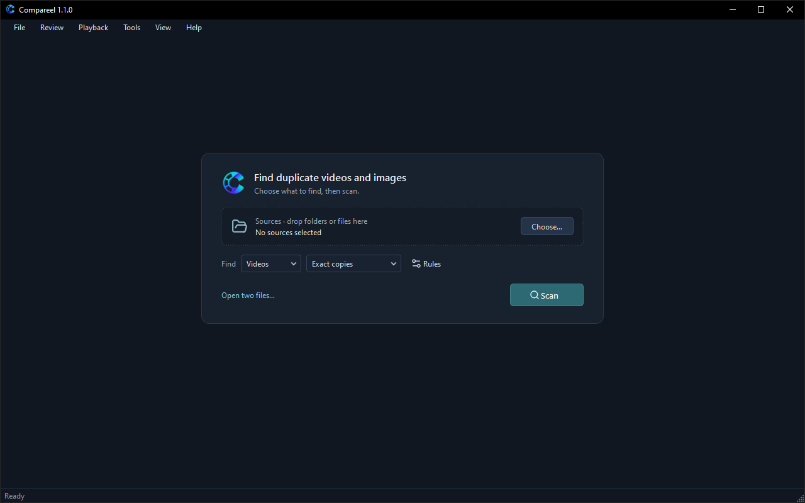
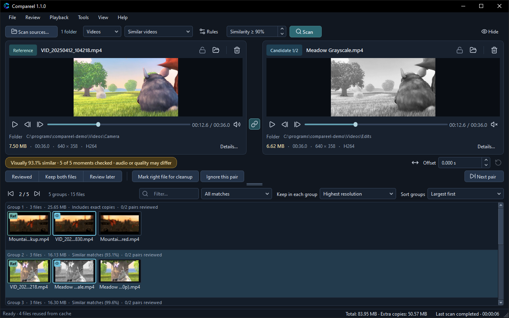
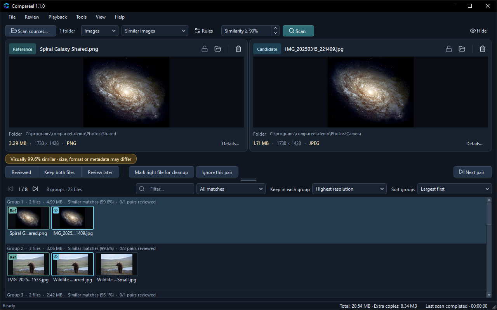

# Compareel

[](https://github.com/turxlab/compareel/releases/latest)
[](LICENSE)
[](#download)

Compareel is a free, open-source duplicate video and image finder for Windows, macOS and Linux that lets you compare exact and similar matches side by side before anything is removed.


## Why Compareel

Many duplicate finders ask you to trust a percentage and delete files unseen. Compareel shows both copies side by side so you can check framing, duration, resolution and audio before deciding what stays.

Everything runs locally on your computer. No files, thumbnails, hashes or scan results leave the machine. Removed files always go to the Recycle Bin or Trash, never permanent deletion, and every group keeps at least one copy. File copies and moves are verified with SHA-256, never overwrite existing files, and can be undone with **File > Undo last copy or move…**.

## Download

Get the packages from the [latest release page](https://github.com/turxlab/compareel/releases/latest). See the [user guide](https://turxlab.github.io/compareel/) for usage instructions and [CHANGELOG.md](CHANGELOG.md) for release notes.

| Platform | File | Notes |
| --- | --- | --- |
| Windows 10/11 (x64) | [Compareel-1.1.0-x86_64-Win.exe](https://github.com/turxlab/compareel/releases/latest) | Installer (current user without admin rights, or all users) |
| Windows 10/11 (x64) | [Compareel-1.1.0-x86_64-Win.zip](https://github.com/turxlab/compareel/releases/latest) | Portable archive; keep `Compareel.exe` with its DLL and plugin folders |
| macOS 12+ | [Compareel-1.1.0.dmg](https://github.com/turxlab/compareel/releases/latest) | Universal disk image for Apple Silicon and Intel |
| Linux (x86_64) | [Compareel-1.1.0-x86_64.flatpak](https://github.com/turxlab/compareel/releases/latest) | Flatpak bundle (`io.github.turxlab.Compareel`); Flathub publishing is planned for later |
| Source code | [Compareel-1.1.0-source.zip](https://github.com/turxlab/compareel/releases/latest) | Complete source for Compareel, bundled third-party libraries and build scripts |

### First start and verification

The binaries are not signed with a paid certificate or notarized by Apple:

- **Windows**: SmartScreen asks for confirmation on first run. Click **More info** and then **Run anyway**.
- **macOS**: Drag Compareel to **Applications**, then Control-click it and choose **Open** once. If macOS shows no **Open** button, click **Open Anyway** in **System Settings > Privacy & Security**.
- **Linux**: The Flatpak app ID is `io.github.turxlab.Compareel` (uses the KDE 6.8 runtime from Flathub; publishing on Flathub itself is planned for later). Install with `flatpak install --user Compareel-1.1.0-x86_64.flatpak` and run with `flatpak run io.github.turxlab.Compareel`.

Every release is built on GitHub Actions from [.github/workflows/build.yml](.github/workflows/build.yml). Check downloads against `SHA256SUMS.txt` on the release page, or verify GitHub's build provenance attestation with `gh attestation verify <file> --repo turxlab/compareel`.

## Features

### Finding



- **Exact copies**: Groups files with identical content verified by a full SHA-256 hash. You can also hash-check similarity results later with **Tools > Verify exact matches in results**.
- **Similar videos**: Compares frames sampled at 10, 30, 50, 70 and 90% of the duration with an adjustable **Similarity threshold**. Turning on **Recognize black borders, mirrored and rotated copies** in **Tools > Scan rules…** adds tolerance for letterboxing, mirroring, 90-degree rotations and light cropping.
- **Similar images**: Compares static, animated and multi-page images after normalizing EXIF orientation, converting ICC color profiles to sRGB, and compositing transparency on white.
- **Advanced criteria**: Finds candidates by combinations of **Same file size**, **Same duration**, **Same resolution**, **Similar first frame** (or **Similar image content**), **Same file name** and **Same file extension** in **Tools > Scan rules…**.
- **Partial clips**: **Tools > Find partial clips in folders…** searches video folders for shared or trimmed segments. Opened pairs stay protected from cleanup until you unlock them.
- **Source controls**: Add folders and files in **Scan sources…**, set **Excluded folders**, or turn on **Compare only between selected folders**. You can also compare two files directly by drag and drop, with **File > Open two files…**, or from Windows Explorer (**Show Compareel in Explorer's Send To menu** in **Tools > Settings…**). Ongoing scans support **Pause scan** and **File > Resume paused scan**.

### Comparing



- **Synchronized playback**: **Playback > Play / pause both** (Space), frame stepping and **Playback > Link video controls** (Ctrl+L) keep both video players in step. Animated images and multi-page files also support linked playback and page stepping.
- **Offset and clip alignment**: Shift the right video in seconds with **Offset**, or run **Playback > Auto-align partial clip** (Ctrl+Shift+A) to align a trimmed clip with a longer video.
- **Comparison views**: Switch **Playback > Comparison view** between **Side by side**, **Wipe**, **Overlay** and **Difference (display aid)**. Hold **B** on a preview to show the other file temporarily.
- **Shared zoom and pan**: Zoom up to 8x with the mouse wheel and drag to pan both panels together. Reset with **Playback > Fit to window** (Ctrl+0).
- **File details and audio check**: Differing size, duration, resolution, format and codec values are highlighted below the previews. Click **Details…** for **File details** (bitrate, frame rate, audio tracks and embedded subtitle tracks), or run **Tools > Compare sampled audio** to compare three 6-second audio windows at the current offset.

### Cleaning up safely



- **Review decisions**: Mark pairs under **Review > Review decision** as **Reviewed** (Ctrl+1), **Keep both files** (Ctrl+2) or **Review later** (Ctrl+3), or hide false matches from future scans with **Review > Ignore this pair** (Ctrl+I). **Keep both files** and **Review later** protect both files from removal until cleared.
- **Protected folders and files**: Mark source folders as **Protected** in **Scan sources…** so their files act as references and cannot be removed. Lock individual files with **Protect this file**.
- **Cleanup plans**: Mark candidates one by one with **Review > Mark right file for cleanup** (Ctrl+M) and remove them with **Review > Move marked files to Recycle Bin…** (**Move marked files to Trash…** on macOS and Linux). To plan across all groups, open **Review > Move other copies to Recycle Bin…** (**Move other copies to Trash…** on macOS and Linux). Choose **Keep in each group** (reference file, highest resolution, longest duration, highest frame rate, largest or smallest file size, newest or oldest modified date, oldest creation date, or oldest EXIF date taken for images), set an optional **Preferred folder**, or save a CSV with **Export plan…**. Every group keeps at least one copy.
- **Recycle Bin and Trash only**: Removals never delete files permanently. Before moving anything, Compareel re-checks file identities on disk so an unplugged drive or changed file cannot remove the last remaining copy in a group.
- **Verified copies, moves and undo**: Right-click a file (or use **File > Left file** and **File > Right file**) for **Copy to folder…**, **Move to folder…** and **Quarantine…**, or transfer all groups via **File > All result files**. Copies are verified with SHA-256 and never overwrite existing files. **File > Undo last copy or move…** (Ctrl+Z) works across restarts.
- **History and sessions**: **Tools > Operation history** logs every removal, copy, move and quarantine with CSV export. Save `.cvsession` files with **File > Save review session…**, export group lists with **File > Export results…**, reopen the previous session with **File > Resume last review**, or inspect an interrupted cleanup with **File > Recover last cleanup review…**.

### Privacy

- **Local processing**: Decoding, hashing, perceptual signatures and caching stay on your computer. Bundled FFmpeg libraries are built decode-only with network protocols, encoders and muxers disabled.
- **Hide previews**: **View > Hide all previews** (Ctrl+Shift+H, or the **Hide** toolbar button) hides previews and thumbnails on screen and pauses automatic saving of the last review while enabled.
- **Clear history**: **Help > Data and privacy** lists every local file Compareel stores. **File > Clear history…** removes selected local records: **Scan results**, **Reviews and decisions**, **File operation history**, **Scan cache** and **Recent folders**.
- **Optional update check**: Outside Flatpak, Compareel asks once after first launch before making any network request. When enabled, it checks GitHub's latest release tag at most once a day, sends nothing about your files, and can be turned off anytime in **Tools > Settings…** (or run manually via **Help > Check for updates…**).

## Supported formats

Source files are never modified or converted. Unreadable, encrypted or damaged files are skipped without stopping the scan and listed with reasons in **Tools > Scan report**.

- **Videos**: Decoded with Windows Media Foundation where available and bundled decode-only FFmpeg 8.1 elsewhere, with no codec packs needed. Supports MP4, MOV, MKV, WebM, AVI, WMV/ASF, MPEG-TS, FLV and other containers, and H.264, HEVC (including 10-bit), VP8, VP9, AV1, MPEG-2, MPEG-4, WMV and ProRes codecs, with rotation metadata and HDR tone mapping applied.
- **Images**: Recognized by content signature rather than file extension alone. Supports JPEG, PNG, WebP, BMP, GIF, TIFF, TGA, HEIC/HEIF and AVIF (`libheif`), animated GIF/APNG/WebP/AVIF/HEIF, multi-page TIFF and HEIF collections, ICO/CUR/ICNS, SVG/SVGZ, PSD/PSB merged composites, JPEG XL (`libjxl`), JPEG 2000, JPEG-LS, EXR/HDR/PFM, Netpbm, DDS, PCX, QOI, camera RAW (DNG, CR2, CR3, NEF, ARW, RAF, ORF, RW2, PEF and others) and JPEG XR (Windows only).

See [packaging/SUPPORTED_FORMATS.md](packaging/SUPPORTED_FORMATS.md) for the full format table, comparison rules and size limits, and the [user guide](https://turxlab.github.io/compareel/) for usage details.

## Languages

Compareel includes 41 interface languages (English plus 40 JSON translation files, with automatic right-to-left layout mirroring) and four themes (**Dark**, **Graphite**, **Light** and **Sand**). It follows your operating system by default (**Use system language**), and you can change language or theme without restarting in **Tools > Settings…**.

Each translation is a single UTF-8 JSON file in `languages/` copied from [languages/template.json](languages/template.json); missing entries fall back to English. See [CONTRIBUTING.md](CONTRIBUTING.md) for steps to add, test or update a translation.

## Build from source

Platform-specific code lives in `src/platform/` (Media Foundation and WIC on Windows, ImageIO on macOS, and POSIX/Qt desktop integration on Linux and macOS); everything else is portable C++20 and Qt 6.

Requirements: CMake 3.24+, a C++20 compiler, Qt 6.5+ (`Core`, `Gui`, `Widgets`, `Concurrent`, `Sql`, `Svg`, `Network`, `DBus` on Linux, and the Qt Image Formats plugins), FFmpeg 8 (`avformat`, `avcodec`, `avutil`, `avfilter`, `swresample`, `swscale`), `libheif` and `zlib` (bundled with Qt on Windows).

### Linux

Debian and Ubuntu package names (Fedora and Arch have equivalents):

```sh
sudo apt install build-essential cmake ninja-build pkg-config zlib1g-dev \
  qt6-base-dev qt6-svg-dev qt6-image-formats-plugins \
  libavformat-dev libavcodec-dev libavutil-dev libavfilter-dev libswresample-dev libswscale-dev libheif-dev
cmake -S . -B build -G Ninja -DCMAKE_BUILD_TYPE=Release
cmake --build build
sudo cmake --install build   # optional: installs binary, desktop entry, metainfo and icons
```

To build the release Flatpak bundle instead, run `tools/build-flatpak.sh 1.1.0`.

### macOS

For local development with Homebrew (targets your host macOS version):

```sh
brew install cmake ninja pkg-config qt ffmpeg libheif
cmake -S . -B build -G Ninja -DCMAKE_BUILD_TYPE=Release \
  -DCMAKE_PREFIX_PATH="$(brew --prefix qt)" -DCMAKE_OSX_DEPLOYMENT_TARGET=""
cmake --build build
```

For the universal macOS 12+ `.dmg` (Apple Silicon and Intel) using official Qt 6.8.3 and decode-only FFmpeg 8.1 and `libheif` built from `third_party/`, install `brew install meson autoconf automake libtool nasm`, then run `tools/Setup-MacDeps.sh` and `./build-macos.sh --package 1.1.0`.

### Windows

Install Visual Studio 2022 (C++ workload), CMake, Ninja and Docker, and place the Qt 6.8.3 MSVC 2022 x64 SDK (with Qt SVG and Qt Image Formats) in `.deps/Qt/6.8.3/msvc2022_64`. Inno Setup 6 is also needed when building the installer:

```powershell
.\tools\Build-FFmpegMinimal.ps1       # decode-only FFmpeg 8.1 -> .deps/ffmpeg-8.1-min
.\tools\Setup-Heif.ps1                # downloads and builds libheif 1.23.7 (via Build-Heif.cmd)
.\tools\build.cmd                     # builds into .build
.\build.ps1 -Package -Version 1.1.0   # installer, portable zip and source zip in release/
```

### Tests

`CoreChecks` builds with the default target, and the remaining check harnesses (`FFmpegChecks`, `ImageChecks`, `HeifChecks`, `ImageGuardChecks`, `AudioEvidenceChecks`, `PartialSearchChecks`, `OperationRecoveryChecks` and others) build on demand. On Windows, run `.\tools\Setup-FFmpeg.ps1` once for the test `ffmpeg.exe` and run `.\tools\Run-Checks.ps1 -BuildDirectory .build` (with fixtures in `.deps\test-fixtures`); on macOS and Linux, run `tools/run-checks.sh --build build` (generates fixtures in `.deps/test-fixtures` with `ffmpeg`). Both scripts execute all check harnesses and the UI self-checks that drive the real window.

## Contributing, security and license

- **Contributing and issues**: Bug fixes and translation updates are welcome; see [CONTRIBUTING.md](CONTRIBUTING.md) before opening a pull request, and open an issue first for larger changes. Use the [issue forms](.github/ISSUE_TEMPLATE/) on [GitHub Issues](https://github.com/turxlab/compareel/issues/new/choose) to report bugs or request features, and include your operating system, package type, Compareel version and relevant summary lines from **Tools > Scan report** (without private file names or paths). Release history is in [CHANGELOG.md](CHANGELOG.md).
- **Security**: Do not open public issues for security vulnerabilities. Report them privately through GitHub Security Advisories as described in [SECURITY.md](SECURITY.md).
- **License**: Copyright © 2026 Ensar Yanar. Compareel is free software licensed under the [GNU General Public License v3.0](LICENSE) (`GPL-3.0-only`).
- **Third-party components**: Dynamically linked and bundled libraries, decode-only build options and license notices are listed in [THIRD_PARTY_NOTICES.md](THIRD_PARTY_NOTICES.md). Each release also publishes `Compareel-<version>-source.zip` with the complete corresponding sources and build scripts.
