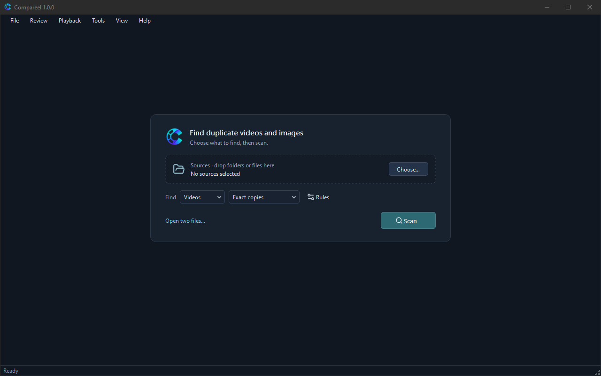

# Compareel

Compareel is a free, open-source (GPL-3.0) desktop program for Windows, macOS, and Linux. It finds duplicate and visually similar videos and images on your computer and lets you compare them side by side before moving unwanted copies to the Recycle Bin (Trash on macOS and Linux). Everything runs locally on your machine.

**Download the latest release:** [github.com/turxlab/compareel/releases/latest](https://github.com/turxlab/compareel/releases/latest)

## Guide contents

- [Getting started](getting-started.md) — Install Compareel on Windows, macOS, or Linux, handle first-run system prompts, and run your first scan.
- [Scanning](scanning.md) — Choose comparison modes, set included, excluded, and protected folders, adjust **Scan rules…**, find partial clips, and use the scan report and cache.
- [Reviewing](reviewing.md) — Compare files side by side with linked playback, time offsets, **Wipe** / **Overlay** / **Difference (display aid)** views, shared zoom, review decisions, filters, and keyboard shortcuts.
- [Cleaning up](cleaning-up.md) — Mark copies or build a cleanup plan with **Keep in each group**, keep protected files untouched, copy, move, or quarantine files, use Undo, and check **Operation history**.
- [Privacy and local data](privacy.md) — See what stays on your computer, use **Privacy mode**, run **Clear history…**, find local data folders per operating system, and manage update checks.
- [FAQ](faq.md) — Answers to common questions about matches, "Not compared" counts, format limits, first-run warnings, and reporting bugs.

## Source code and license

Compareel is distributed under the GNU General Public License v3.0. Source code, release checksums, and issue reports are on [GitHub](https://github.com/turxlab/compareel).
