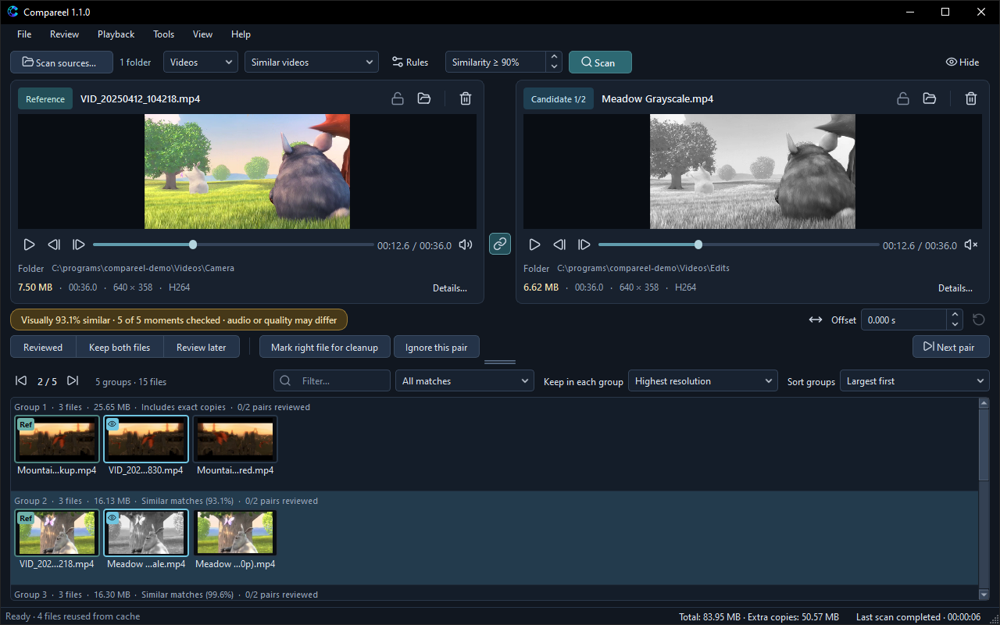

# Reviewing

Compareel shows two files side by side above the list of result groups so you can inspect visual differences, timing, metadata, and audio before anything is removed.

## Side-by-side layout

- **Reference (left panel)** — The first file in the active group row (badged **Ref**) is loaded on the left and kept by default.
- **Candidate (right panel)** — The selected candidate in the group (or **Candidate X/Y** when a group has three or more files) is loaded on the right. Click any thumbnail in a group row (or use **Next pair** or the arrow keys in the results list) to compare it on the right.
- **Change the reference for one group** — Right-click a candidate thumbnail in the group row and choose **Make reference** to move that file to the left panel for that group.
- **Metadata bar and File details** — Under each preview, Compareel shows file size, duration (videos), resolution, and codec or format. Values that differ between the left and right file are highlighted. Click **Details…** to open **File details**, which also lists frame rate, video bitrate, audio codec/channels/sample rate, embedded **Subtitles** track counts, and the file's modified timestamp. Note that embedded subtitles are listed for inspection only; they are not rendered during playback or compared during scans.
- **Panel buttons** — Each panel header has three buttons: **Protect this file** (lock icon), **Show in Explorer** (**Show in Finder** on macOS, **Show in file manager** on Linux), and **Move to Recycle Bin** (**Move to Trash** on macOS and Linux).

## Linked playback, offset, and audio check

In **Videos** mode, the chain button between the two seek bars (or **Playback** > **Link video controls**, `Ctrl+L`, `Cmd+L` on macOS) links both players:

- Playing, pausing (`Space`), scrubbing, seeking, restarting (**Playback** > **Restart both**, `Ctrl+Home`), and stepping one frame backward or forward (**Previous frame** / **Next frame**) move both videos together.
- The left player starts with audio enabled and the right player starts muted so both tracks do not talk over each other. Use **Mute / unmute** on either side to switch audio.
- **Offset** (-86400 to +86400 seconds) shifts the right video relative to the left. Positive values show a later moment on the right. Click **Reset alignment** next to **Offset** to return to `0.000 s`, or click **Auto-align partial clip** (`Ctrl+Shift+A`, `Cmd+Shift+A` on macOS) to estimate the offset between a trimmed clip and a longer video.
- **Compare sampled audio** — Choose **Tools** > **Compare sampled audio** to check three short audio windows of the primary audio track at the current offset. The result is informational only and never authorizes automatic deletion.

In **Images** mode:

- **Animated images** can be played together or stepped frame by frame; when unzoomed and not in **Wipe** view, you can also press and hold on an animated image preview to play it from the start.
- **Multi-page documents** (such as multi-page TIFF or HEIF collections) show a page selector so you can step through pages.

## Comparison views

Switch how the two previews are drawn from **Playback** > **Comparison view**:

- **Side by side** — Shows the left reference and right candidate in their own panels (default).
- **Wipe** — Splits the right preview between the left and right files. Drag horizontally across the right preview to move the divider line.
- **Overlay** — Blends both images or video frames at 50% opacity in the right preview to check framing, crops, or watermarks.
- **Difference (display aid)** — Highlights pixel-by-pixel differences in the right preview. Small compression differences still appear even when two encodes look similar to the eye.

**Quick flip (`B`):** Click either preview to focus it, then hold `B` to temporarily show the other file in the exact same spot; release `B` to flip back.

## Shared zoom and pan

- Scroll the mouse wheel over either preview to zoom in or out (from `0.5x` up to `8x`).
- Drag inside either preview to pan while zoomed in. Zoom level and pan position stay synchronized across both panels.
- Double-click either preview or choose **Playback** > **Fit to window** (`Ctrl+0`, `Cmd+0` on macOS) to reset zoom and pan.

## Review decisions and ignored pairs

The review bar below the players (and **Review** > **Review decision**, or right-clicking a candidate thumbnail) records your decision for the current pair by file identity, so decisions survive rescans unless the files change:

- **Reviewed** (`Ctrl+1`) — Marks the pair as checked. It does not block cleanup.
- **Keep both files** (`Ctrl+2`) — Protects both files in the pair from cleanup marks, bulk cleanup, moves, and Recycle Bin (Trash) removal until you clear the decision.
- **Review later** (`Ctrl+3`) — Marks the pair to revisit later and likewise protects both files from cleanup and removal until cleared.

Pressing the active decision button or shortcut a second time (or choosing **Review** > **Review decision** > **Clear review decision**) returns the pair to unreviewed. To clear every saved review note across all scans, choose **Review** > **Review decision** > **Reset all review decisions…**.

If two files are unrelated false matches that you do not want grouped together again:

- Click **Ignore this pair** (`Ctrl+I`, `Cmd+I` on macOS) in the review bar or **Review** menu. Compareel hides that pair immediately, regroups any remaining files in the group, and remembers the ignored pair on future scans.
- Choose **Review** > **Reset ignored pairs** and scan again if you want ignored pairs to reappear.

Click **Next pair** (`Alt+Down`, `Option+Down` on macOS) to step through each candidate in the current group and then move on to the next group.

## Filtering, reference order, and sorting

The bar directly above the result rows controls which groups are shown and how files are ordered:

- **Filter…** — Type part of a file name or folder path to filter visible groups.
- **Match-type filter** — Show **All matches**, **Exact copies**, **Includes exact copies**, or **Similar matches**. After a similarity or advanced scan, run **Tools** > **Verify exact matches in results** first if you want Compareel to hash same-size files for **Exact copies** / **Includes exact copies**.
- **Keep in each group** — Sets which file becomes the default left reference in each group (protected files always come first):
  - **Highest resolution**
  - **Largest file**
  - **Longest duration** (videos only)
  - **Oldest file**
  - **Newest file**
  - **Oldest creation date**
  - **Oldest date taken (EXIF)** (images only)
  - **First by name**
- **Sort groups** — Orders the result list by **Largest first**, **Smallest first**, **Longest first** (videos only), **Shortest first** (videos only), **Highest resolution**, **Lowest resolution**, **Filename**, **Highest similarity**, or **Lowest similarity**.

You can also export all current result groups to CSV via **File** > **Export results…**.

## Keyboard shortcuts

Press `F1` (**Help** > **Keyboard shortcuts**) at any time to view shortcuts inside the app. On macOS, use `Cmd` in place of `Ctrl` and `Option` in place of `Alt`.

| Shortcut (Windows / Linux) | macOS | Action |
|---|---|---|
| `Ctrl+O` | `Cmd+O` | **Scan sources…** |
| `Ctrl+Shift+O` | `Cmd+Shift+O` | **Open two files…** |
| `Ctrl+S` | `Cmd+S` | **Save review session…** |
| `Ctrl+Shift+L` | `Cmd+Shift+L` | **Open review session…** |
| `Ctrl+Z` | `Cmd+Z` | **Undo last copy or move…** |
| `F5` | `F5` | **Scan** |
| `Ctrl+Shift+P` | `Cmd+Shift+P` | **Pause scan** |
| `Esc` | `Esc` | **Stop scan** |
| `Alt+Left` / `Alt+Right` | `Option+Left` / `Option+Right` | **Previous group** / **Next group** |
| `Alt+Down` | `Option+Down` | **Next pair** |
| `Up` / `Down` (in results list) | `Up` / `Down` | Previous / next visible group |
| `Left` / `Right` (in results list) | `Left` / `Right` | Previous / next candidate in group |
| `Home` / `End` (in results list) | `Home` / `End` | First / last candidate in group |
| `Shift+Mouse wheel` (on row) | `Shift+Mouse wheel` | Scroll group thumbnails sideways |
| `Ctrl+1` | `Cmd+1` | **Reviewed** |
| `Ctrl+2` | `Cmd+2` | **Keep both files** |
| `Ctrl+3` | `Cmd+3` | **Review later** |
| `Ctrl+I` | `Cmd+I` | **Ignore this pair** |
| `Ctrl+M` | `Cmd+M` | **Mark right file for cleanup** |
| `Delete` (after clicking a preview) | `Delete` or `Cmd+Backspace` | **Move focused file to Recycle Bin…** (**Move focused file to Trash…**) |
| `Space` | `Space` | **Play / pause both** |
| `Ctrl+Home` | `Cmd+Home` | **Restart both** |
| `Ctrl+L` | `Cmd+L` | **Link video controls** |
| `Ctrl+Shift+A` | `Cmd+Shift+A` | **Auto-align partial clip** |
| `Ctrl+0` | `Cmd+0` | **Fit to window** |
| Hold `B` (on focused preview) | Hold `B` | Show the other file while held |
| `Ctrl+Shift+,` | `Cmd+Shift+,` | **Scan rules…** |
| `Ctrl+,` | `Cmd+,` | **Settings…** |
| `Ctrl+Shift+H` | `Cmd+Shift+H` | **Hide all previews** |
| `F1` | `F1` | **Keyboard shortcuts** |
| `Alt+F4` / `Ctrl+Q` | `Cmd+Q` | **Exit** (**Quit Compareel** on macOS) |

Next: [Cleaning up](cleaning-up.md) explains how to remove, copy, move, or quarantine copies while keeping at least one file in every group.
