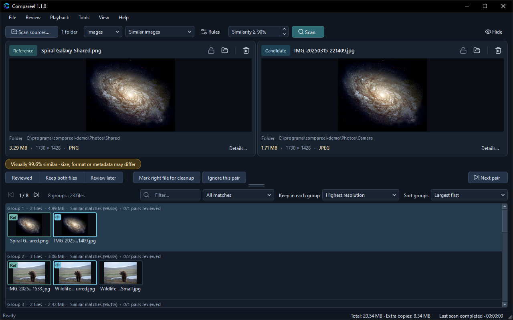

# Scanning

Compareel scans either **Videos** or **Images** in a single run. Select the media type and comparison mode on the welcome card or in the top toolbar, then click **Scan** (`F5`).

## Comparison modes

### Exact copies

Groups files whose content is identical byte for byte, verified with a full SHA-256 hash. Compareel first groups files by exact byte size, so a file whose size is unique is never read in full.

Only **Exact copies** proves that two files are identical. Two exact copies can still have different file names, folder paths, or modified dates.

### Similar videos

Compares visual signatures sampled at five points across each video: 10%, 30%, 50%, 70%, and 90% of the duration. Two videos are compared only when their lengths are within **Duration tolerance (seconds)** (0.20 seconds by default). Frames that are mostly black or single-color slides with almost no detail do not count as visual evidence.

In the toolbar, **Similarity ≥ %** sets how close the sampled frames must be (70% to 100%, 90% by default). Lower values find more candidates and can increase false matches.

**Similar videos** compares sampled video frames only. It does not compare audio tracks, embedded subtitles, metadata, bitrate, or encoding quality.

### Similar images

Compares visual signatures after normalizing EXIF or container orientation, converting ICC color profiles to sRGB, and compositing transparency onto white. Files are recognized by their content signature, not only by file extension.

- **Animated images** (such as animated GIF, APNG, WebP, AVIF, and HEIF) are sampled at five points across their duration. A static image never matches an animation.
- **Multi-page images** (multi-page TIFF and HEIF/AVIF collections) are sampled across pages.
- **Icons** (`ico`, `cur`, `icns`) compare the largest image entry.
- **Layered files** (`psd`, `psb`) compare the merged composite.
- **Vector files** (`svg`, `svgz`) are rasterized on white; external references and scripts are rejected.
- **HDR images** (`exr`, `hdr`, `pic`, `pfm`, `phm`) are tone-mapped for comparison.
- **Camera RAW files** compare either embedded previews or system-developed RAW images; those two kinds of evidence are never matched against each other.
- **JPEG XL** (`jxl`) is decoded through `libjxl` in FFmpeg. **JPEG XR** (`jxr`, `wdp`, `hdp`) requires Windows (WIC).

### Advanced criteria

Finds candidates that share a custom combination of attributes chosen in **Tools** > **Scan rules…** (`Ctrl+Shift+,`, `Cmd+Shift+,` on macOS). Selecting **Advanced criteria** opens **Scan rules…** so you can pick from:

- **Same file size**
- **Same duration** (videos only)
- **Same resolution**
- **Similar first frame** (videos) or **Similar image content** (images)
- **Same file name**
- **Same file extension**

Advanced criteria find candidates for review; they do not prove identical content.

## Scan sources

Open **File** > **Scan sources…** (`Ctrl+O`, `Cmd+O` on macOS), click **Scan sources…** in the toolbar, or click the source count link next to it.

- **Included folders and files** — Click **Add folder…** or **Add files…**, or drag folders and files onto the welcome card. Select rows and click **Remove** (or press `Delete`, or `Cmd+Backspace` on macOS) to remove them, or click **Remove all** to clear the list.
- **Subfolders** — Tick or untick the **Subfolders** column per folder, or toggle **Include subfolders for all folders** below the list.
- **Protected** — Tick **Protected** for reference libraries or backup folders. Protected folders are scanned so matches against them are found, but Compareel refuses to mark, move, quarantine, or send any file inside them to the Recycle Bin (Trash on macOS and Linux). Saving changes in **Scan sources** updates folder protection on already open results right away.
- **Excluded folders** — Add subfolders you want Compareel to skip completely while scanning parent folders.
- **Compare only between selected folders** — Requires at least two source entries. Each file (including files in its subfolders) is compared only against files from a different selected root, ignoring duplicates within the same root folder.
- **Save** vs **Save and scan** — Click **Save and scan** to scan immediately, or click **Save** to store your source list without starting a scan.

## Scan rules

Open **Tools** > **Scan rules…** (`Ctrl+Shift+,`, `Cmd+Shift+,` on macOS) or click **Rules** in the toolbar to adjust four sections:

- **Matching**
  - **Similarity threshold** — Minimum match percentage (70% to 100%).
  - **Duration tolerance (seconds)** — Maximum length difference allowed between two videos (0 to 60 seconds). Hidden in **Images** mode.
  - **Recognize black borders, mirrored and rotated copies** — Enabled by default. Adds tolerance for letterboxing or pillarboxing, horizontal or vertical mirroring, 90-degree rotations, and light center cropping.
- **Advanced criteria** — The checkboxes used when the comparison mode is **Advanced criteria**.
- **File filters**
  - **Minimum size** and **Maximum size (0 = unlimited)** — Skip files outside your chosen size range (`KB`, `MB`, or `GB`).
  - **Video extensions** / **Image extensions** — Leave blank to scan all supported formats, or enter a comma-separated list (such as `mp4, mkv, mov`) to scan only those extensions.
  - **Excluded extensions** — Enter a comma-separated list (such as `gif, webp, svg`) to skip specific extensions.
- **Performance**
  - **Parallel reads** (1 to 16, 2 by default) — Target number of files read at the same time. Compareel automatically caps parallel readers per drive based on available memory and detected storage type (**SSD / NVMe**, **HDD (rotational)**, **Network / removable**, or **Unknown (conservative)**) so spinning hard disks and network shares are not overloaded.

## Pausing and resuming a scan

While a scan is running, click **Pause scan** (`Ctrl+Shift+P`, `Cmd+Shift+P` on macOS) in the toolbar or under **File**. Compareel keeps the signatures and hashes already read in the local cache and saves the remaining file list (up to 100,000 files or 32 MiB).

Choose **File** > **Resume paused scan** to continue where you left off, even if you closed Compareel or your computer restarted in the meantime. Clicking **Stop scan** (`Esc`) cancels the scan without keeping a paused state.

## Verifying exact copies after a similarity scan

In **Similar videos**, **Similar images**, or **Advanced criteria** mode, Compareel does not compute full-file SHA-256 hashes during the scan itself. If you want to check which result files are byte-for-byte identical afterwards:

- Choose **Tools** > **Verify exact matches in results** to hash same-size files inside your result groups.
- Choose **Tools** > **Exact-copy groups first** to move groups with verified exact copies to the top of the list.

## Partial video clips

A short trimmed clip and the full-length recording it came from have different durations, so **Similar videos** will not group them together. Compareel includes two separate tools for trimmed or shared segments:

- **Across folders:** Choose **Tools** > **Find partial clips in folders…** to run a timeline search across your scan sources (or a single folder you pick when no sources are saved). Results open in **Partial-clip candidates — not duplicate groups**, listing **Overlap**, **Offset**, and **Similarity** for each pair. Select a row and click **Open pair for review** to load both videos at the detected offset. Because a trimmed clip is usually not a full replacement for the longer video, Compareel locks (**Protected**) both files by default until you unlock one yourself.
- **Current pair:** When two videos are already loaded in the players, click the align button next to **Offset** or choose **Playback** > **Auto-align partial clip** (`Ctrl+Shift+A`, `Cmd+Shift+A` on macOS) to estimate the time offset between them. Alignment helps you inspect a shared section; it is never treated as proof of a duplicate.

## Scan report

Choose **Tools** > **Scan report** after any scan to inspect:

- Total files discovered, analyzed, and grouped.
- **Not compared** counts (files skipped without full decoding because no other file shared the same byte size in **Exact copies**, no video had a matching duration in **Similar videos**, the file fell outside size filters, or video frames lacked enough visual detail).
- Read or decode errors with `0x...` diagnostic codes, grouped by file extension.
- Time spent enumerating, reading, and grouping files, the parallel read limit used, and the detected storage type.

Click **Save scan report…** in the dialog to save a plain-text copy anywhere. Compareel also writes the latest report to `last-scan-report.txt` in its local data folder.

## Scan cache

When **Store media cache on disk** is enabled (default in **Tools** > **Settings…**), Compareel saves file identities (volume, file index, size, and modified timestamp), SHA-256 hashes, metadata, and compressed visual signatures in a local SQLite database (`scan-cache-v1.sqlite`). Thumbnails are loaded on demand when rows are visible on screen. Media payloads in the current cache are capped at 256 MiB and 100,000 entries.

On later scans, unchanged files reuse their cached signatures instead of being decoded again.

- To clear cached media data without losing your review decisions, ignored pairs, or operation history, open **Tools** > **Settings…** and click **Clear scan cache**.
- Turning off **Store media cache on disk** disables caching for future scans and clears existing cached media payloads.

Next: [Reviewing](reviewing.md) covers side-by-side playback, comparison views, review decisions, filters, and keyboard shortcuts.
